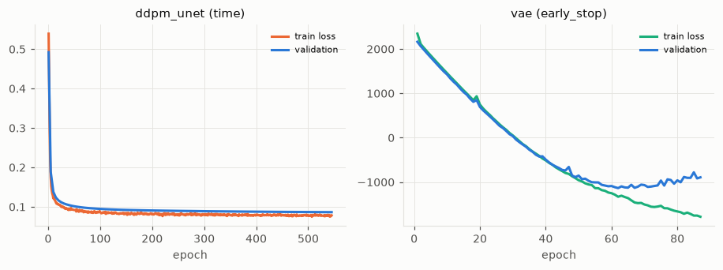
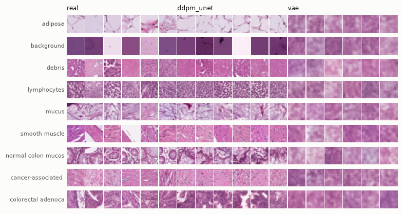
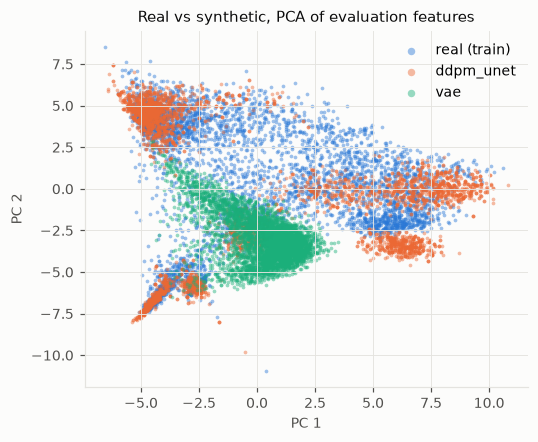
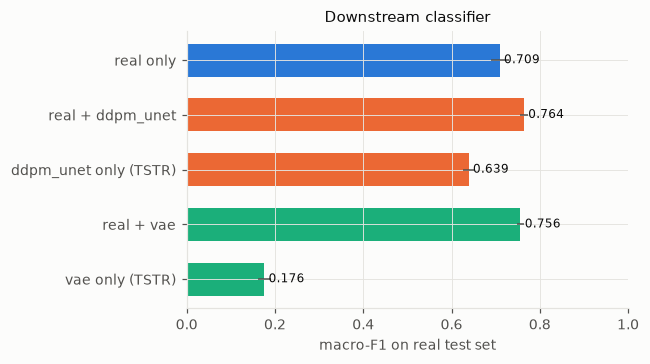

# Generative modeling report: pathmnist

*Objective:* Only a small labelled subset (~5% of training patches) is available. Generate class-conditional synthetic tissue patches, assess whether augmenting the subset improves a downstream classifier, and whether a classifier trained on synthetic data alone transfers to real data.  
*Run:* 2026-10-05T22:07:55 on mps (Apple GPU (MPS) on arm64); full mode; seed 774; plan source **llm**; narrative by LLM (claude-opus-5-5); total time 37.9 min.

## 1. Executive summary
The objective was to test whether class-conditional synthetic patches help when only 5% of PathMNIST training labels are available. Two questions were asked: does augmenting the 4,498-image labelled subset improve a downstream CNN, and does a classifier trained on synthetic data alone transfer to real patches? The agent trained a class-conditional DDPM (U-Net, classifier-free guidance 1.5) as the primary generator and a conditional VAE for comparison. All classifiers were scored on the predefined 7,180-image test split. Adding DDPM samples at a 1:1 ratio raised test macro-F1 from 0.709 (real-only) to 0.764, a gain of +0.055 (95% CI +0.027 to +0.080; P(gain>0)=1.0). A classifier trained only on DDPM samples reached 0.639 macro-F1, which is −0.070 below real-only (CI −0.098 to −0.045), or about 90% of the real-data score. There was no sign of memorisation (DCR ratio 1.06, 0.7% of samples too close, 0 exact copies). Bottom line: DDPM augmentation gives a modest gain that is statistically clear. Synthetic-only training does not reach parity. The DDPM was cut off by its time limit while still improving, and the test split is strongly shifted from training (Fréchet ratio 24.4), so both findings need those caveats.

## 2. Data and objective
- **Data.** PathMNIST has 107,180 RGB patches of 28×28×3 (p = 2,352; integer values 0–255) in 9 tissue classes. It comes with predefined splits: train 89,996, val 10,004, test 7,180. No values are missing and there are no exact duplicates. However, **5% of patches are near-duplicates**, which is why memorisation checks were required.
- **Class balance.** Imbalance is mild (ratio 1.64). The smallest class is normal colon mucosa (9,504; 8.9% of all patches) and the largest is colorectal adenocarcinoma epithelium (15,550). Because imbalance is mild, the agent used proportional 1:1 augmentation rather than rebalancing.
- **Dimensionality.** The estimated intrinsic dimension is about 50.4, and 154 principal components explain 90% of variance. This was used to size the VAE latent (64) and to argue that about 4,500 images could support a small conditional generator.
- **Label budget.** The objective fixes the label budget at 5%. The agent drew a stratified subsample of 4,498 training images, with between 398 (normal colon mucosa) and 652 (adenocarcinoma epithelium) images per class. The generator, the feature extractor and every classifier saw only this subset. The validation split was cut to 501 images for early stopping and for the IID fidelity holdout.
- **Train/test shift.** This was the most consequential property, although it was found only at evaluation. Real test patches sit far further from the training distribution than IID validation patches do: Fréchet distance 10.61 vs 0.43 in the evaluation feature space, a ratio of 24.4, which triggered the shift flag. All test-split utility numbers therefore measure transfer to a shifted distribution. The record does not say what causes the shift.

| profile | value |
|---|---|
| modality | image |
| n samples | 107180 |
| n features | 2352 |
| feature types (cont/disc/bin/cat) | 2352/0/0/0 |
| classes | 9 (imbalance 1.6, smallest 'normal colon mucosa' n=9504) |
| missing cells | 0.0% |
| zero fraction | 0.0% |
| PCA components for 90% variance | 154 |
| near-duplicate fraction | 0.05 |
| predefined splits | {'train': 89996, 'val': 10004, 'test': 7180} |

## 3. How the agent decided
**Whether to generate at all.** Yes. Both the augmentation-gain question and the TSTR question need synthetic samples, so no non-generative alternative could answer them. The real-only classifier served as the baseline that would show whether the samples help.

**Primary model: conditional DDPM.**
- The agent judged about 4,500 images enough for a small DDPM, which has the best expected fidelity and diversity in the model library.
- WGAN-GP was rejected because adversarial training is unstable at this scale and mode collapse would hit minority classes first. It was also rejected as a third model: only 750 s of budget would have remained, too few generator updates for a fair comparison.
- Pixel-space flows (RealNVP/MAF) were rejected because at p = 2,352 they need deep multi-scale architectures beyond the budget.

**DDPM settings.**
- base_channels 32, T = 1,000 training steps with 100 strided sampling steps, v-prediction, learning rate 2e-4, batch 128, 10% label dropout, 1,500 s cap.
- The LLM planner lowered guidance from 2.0 to 1.5. Its reasoning: TSTR needs samples that cover each class's real variation, and strong guidance trades recall and coverage for precision. Guidance of 0 was rejected for risking weak class fidelity with only 400–650 images per class.
- base_channels 64 was rejected because it costs about 4× more per step on MPS, so fewer optimiser updates would fit in the time cap.

**Comparison model: conditional VAE.**
- The planner revised the rule-based proposal (latent 32, β 1.0, batch 256) to latent 64, β 0.5, batch 128, 3 layers.
- Reasoning: a 32-dimensional latent sits below the intrinsic dimension (about 50), and full KL weight gives the blurriest samples, which would make the comparison uninformative. β 0.1 was rejected because the aggregate posterior would drift from the prior.

**Sampling.** 1:1 synthetic-to-real per class, 4,499 samples planned and 4,495 actually added. A 2:1 ratio was rejected because generator bias would dominate the training data, and because equal sizes keep TSTR comparable with training on the real subset.

**Evaluation design.**
- Primary metric: macro-F1 gain. Fréchet distance was rejected as primary because it measures fidelity, not the improvement the objective asks about. TSTR was kept secondary because it answers the secondary question.
- Per-class recall was added because a macro-averaged gain can hide classes that synthetic data harms.
- Fidelity metrics were computed in a domain feature space: the 128-d penultimate layer of a CNN trained on the 4,498 real training images (validation accuracy 0.850). Inception features were rejected as mis-specified for histology.
- Classifier results are averaged over 3 seeds.
- Pretraining a generator on the unlabelled 95% of training data was noted as a follow-up, not attempted.

Full decision log: `decision_log.json`. Summary:

| step | decision | chosen | source |
|---|---|---|---|
| system | compute | mps, full mode | system |
| profile | data modality | image | system |
| objective | task type | augmentation | heuristic |
| warrant | use a generative model? | yes | heuristic |
| preprocessing | labelled training subset | 5.0% stratified subsample of train | heuristic |
| model | primary model | ddpm_unet | heuristic |
| model | comparison model | vae | heuristic |
| hyperparameters | ddpm_unet (primary) | batch_size=128, base_channels=32, timesteps=1000, sample_steps=100, gu | heuristic |
| hyperparameters | vae (comparison) | batch_size=256, latent_dim=32, hidden_dim=256, beta=1.0, lr=0.001, wei | heuristic |
| sampling | how many samples, of what | augment_per_class | heuristic |
| evaluation | evaluation criteria | precision_recall, density_coverage, frechet_distance, mmd, memorizatio | heuristic |
| hyperparameters | Lower the DDPM classifier-free guidance scale | guidance_scale=1.5 (proposal 2.0); other DDPM settings kept, weight_de | llm |
| hyperparameters | Resize the VAE latent and soften the KL weight | latent_dim=64, beta=0.5, batch_size=128, n_layers=3 (proposal latent_d | llm |
| model | Do not add a third model (wgan_gp) | Two models: ddpm_unet (primary) and vae (comparison), 2,250 s total ou | llm |
| sampling | Keep the 1:1 per-class augmentation ratio, which follows the | augment_per_class, n_total=4499 (same as proposal) | llm |
| evaluation | Add per-class recall; make utility metrics central; keep mac | Add per_class_recall; primary=macro_f1_gain; baseline real_only_classi | llm |
| preprocessing | Generator and classifiers see only the 5% stratified labelle | 5% stratified subsample of the predefined train split (about 4,500); v | llm |
| planner | planner used | llm | llm |
| preprocessing | data split | train 4498 / val 501 / test 7180 | system |
| evaluation | feature space | 128-d penultimate features of a CNN trained on the 4498 real training  | system |
| critic | trigger: low_diversity | vae | critic |
| critic | revise the plan? | none | critic |
| recommendation | verdict | Synthetic augmentation reliably improves macro-F1: +0.055 (95% CI +0.0 | system |

## 4. Models and training

| model | role | representation | conditional | parameters | epochs | time (s) | stopped | hyperparameters |
|---|---|---|---|---|---|---|---|---|
| ddpm_unet | primary | pixels | True | 1,075,846 | 545 | 1500.2 | time | base_channels=32, timesteps=1000, sample_steps=100, guidance_scale=1.5, p_uncond=0.1, lr=0.0002, batch_size=128, max_epochs=2000, weight_decay=0.0 |
| vae | comparison | pixels | True | 3,540,870 | 87 | 57.2 | early_stop | latent_dim=64, hidden_dim=256, n_layers=3, beta=0.5, lr=0.001, batch_size=128, max_epochs=2000, weight_decay=0.0 |

## 5. Evaluation
Each synthetic metric below is read against two real references: the IID validation holdout (n = 501) and the shifted test split. Fidelity was computed on 501 synthetic samples per model.

**Fidelity and diversity (DDPM)**

| Metric | DDPM | IID holdout | Real test | VAE |
|---|---|---|---|---|
| Precision | 0.800 | 0.966 | 0.834 | 0.529 |
| Recall | 0.557 | 0.967 | 0.821 | 0.130 |
| Density | 0.678 | 1.006 | 0.555 | 0.183 |
| Coverage | 0.169 | 0.409 | 0.154 | 0.006 |
| Fréchet distance | 7.24 | 0.43 | 10.61 | 74.68 |
| MMD | 0.0232 | −0.0005 | 0.0183 | 0.406 |

- **Against the IID holdout,** the DDPM is clearly short of real data. Recall (0.557 vs 0.967) and coverage (0.169 vs 0.409) show that much of the real training manifold is not reproduced, and Fréchet distance is about 17× the reference.
- **Against the real test split,** precision, coverage and Fréchet distance are comparable or better. Recall, however, is still clearly lower (0.557 vs 0.821).
- **Reading the test comparison carefully.** A generator trained on the training data *should* sit closer to the training distribution than shifted test data does. Being 'on par with test' shows the samples are no more foreign than genuinely new patches. It does not show they are high-fidelity.
- **The VAE** is an order of magnitude worse on every metric (Fréchet distance 74.7, coverage 0.006). The critic's low-diversity trigger fired on it: recall 0.130 is below half the holdout recall.

**Memorisation**
- DDPM: median distance to the nearest training image is 1.965 for synthetic samples vs 1.852 for real holdout images (DCR ratio 1.06). 0.71% of samples are 'too close' (the rule-based summary gives about 5% as the expected rate), there are 0 exact copies, and a Mann–Whitney test gives no evidence that synthetic samples are closer to training images than real holdout images are (p = 0.99999).
- VAE: DCR ratio 2.67, so its samples are far from the training data, consistent with blur rather than copying.
- So memorisation is unlikely to be inflating fidelity or TSTR. The check covered 501 samples, in a feature space learned from the same training images.

**Utility: augmentation (primary)**
- DDPM-augmented macro-F1 is 0.764 (SD 0.009) vs 0.709 (SD 0.020) for real-only. The gain is +0.055 [0.027, 0.080]. Balanced accuracy rose from 0.723 to 0.771.
- Per-class recall changes, real-only → DDPM-augmented:
  - smooth muscle 0.549 → 0.715
  - adipose 0.815 → 0.962
  - debris 0.576 → 0.695
  - mucus 0.639 → 0.712
  - adenocarcinoma epithelium 0.841 → 0.884
  - background stayed at 1.000
  - normal mucosa 0.849 → 0.856 (essentially flat)
  - **lymphocytes fell 0.899 → 0.782**, the one clear per-class harm
  - cancer-associated stroma was flat at about 0.33 (0.337 → 0.333)
- The VAE's augmentation gain is nearly as large: +0.047 [0.020, 0.072], and the CI overlaps the DDPM's. This is despite near-useless VAE samples (TSTR 0.176). VAE augmentation even improved lymphocytes (0.917) and mucus (0.799) more than the DDPM did. One possibility, not tested in this run, is that part of the augmentation gain comes from a generic regularisation effect rather than class-faithful content. The run had no classical-augmentation baseline (flips or rotations) to tell these apart.

**Utility: TSTR (secondary)**
- Training on DDPM samples only gives 0.639 macro-F1 (balanced accuracy 0.646), which is −0.070 [−0.098, −0.045] vs real-only. Transfer is substantial but not at parity.
- Per-class TSTR recall:
  - weak: smooth muscle 0.271, debris 0.459, lymphocytes 0.517, mucus 0.595
  - strong: background 1.000, normal mucosa 0.910, adipose 0.909, adenocarcinoma epithelium 0.789
- The weak classes line up with where augmentation was neutral or harmful (lymphocytes), which suggests the DDPM's class conditioning is marginal for those tissue types.
- VAE TSTR collapses to 0.176 (−0.533 vs real-only). Recall is about 0 for adipose, lymphocytes and adenocarcinoma epithelium.

**Cancer-associated stroma** recall is about 0.33–0.37 under every condition (real-only 0.337, augmented 0.333, TSTR 0.368). This ceiling is not caused by the generator. It points to a shift or label-ambiguity problem that synthetic data cannot fix.

**What the evidence does not show**
- That DDPM augmentation beats cheap classical augmentation, since that was not tested.
- That the DDPM is better than the VAE *for augmentation*, since the CIs overlap.
- That the per-class differences are significant, since per-class recalls are reported without intervals over only 3 seeds.

Feature space: 128-d penultimate features of a CNN trained on the 4498 real training images (val accuracy 0.850). Real train n=4498; reference holdout = validation split (IID with train; predefined test split reported separately), n=501; synthetic sets scored at the holdout's n.

**Train/test shift:** Frechet distance of the test split is 24.40x that of IID holdout data -- test split is further from train than IID holdout data are; downstream utility on test then measures transfer to a shifted distribution.

### Fidelity, diversity, memorization

| | precision | recall | density | coverage | frechet_distance | mmd | dcr_ratio | too_close_fraction | mannwhitney_p_synth_closer | memorization_flag | n_synth_eval |
|---|---|---|---|---|---|---|---|---|---|---|---|
| real holdout, IID (reference) | 0.966 | 0.967 | 1.006 | 0.409 | 0.435 | -0.000499 | nan | nan | nan | nan | nan |
| real test split (shift diagnostic) | 0.834 | 0.821 | 0.555 | 0.154 | 10.609 | 0.018 | nan | nan | nan | nan | nan |
| ddpm_unet | 0.800 | 0.557 | 0.678 | 0.169 | 7.238 | 0.023 | 1.061 | 0.007 | 1.000 | False | 501 |
| vae | 0.529 | 0.130 | 0.183 | 0.006 | 74.676 | 0.406 | 2.665 | 0.000 | 1.000 | False | 501 |

Downstream classifier: CNN: 3 conv blocks (32-64-128 channels, batch norm, ReLU, max-pool) + global average pooling + linear head; Adam lr 1e-3, weight decay 1e-4, batch 128; early stopping on real validation loss (patience 8), cap 60s.

### Downstream utility (real test set)

| | macro_f1 | macro_f1_sd | balanced_accuracy | target_class_recall | n_seeds |
|---|---|---|---|---|---|
| real only | 0.709 | 0.020 | 0.723 | nan | 3.000 |
| real + ddpm_unet | 0.764 | 0.009 | 0.771 | nan | 3.000 |
| ddpm_unet only (TSTR) | 0.639 | 0.012 | 0.646 | nan | 3.000 |
| real + vae | 0.756 | 0.008 | 0.763 | nan | 3.000 |
| vae only (TSTR) | 0.176 | 0.015 | 0.252 | nan | 3.000 |

Gains with paired-bootstrap 95% intervals:

| | gain | ci_low | ci_high | prob_positive |
|---|---|---|---|---|
| ddpm_unet: augmented - real: macro-F1 | 0.055 | 0.027 | 0.080 | 1.000 |
| ddpm_unet: synthetic-only - real: macro-F1 | -0.070 | -0.098 | -0.045 | 0.000 |
| vae: augmented - real: macro-F1 | 0.047 | 0.020 | 0.072 | 1.000 |
| vae: synthetic-only - real: macro-F1 | -0.533 | -0.561 | -0.505 | 0.000 |

*Real (left block) vs synthetic samples per class.*

*Real vs synthetic in the evaluation feature space (PCA).*

*Downstream classifier by training condition.*

## 6. Critic and revision
- **Conclusion.** The critic judged the results adequate for the main objective and chose **no revision** (action 'none'). No revision ran.
- **The one trigger.** The only automatic trigger was low diversity on the **VAE comparison model**: recall 0.130 < 0.5 × 0.967. It suggested retuning β to 0.25. The critic declined: a better VAE would not change the primary model's macro-F1 gain, and closing a roughly 10× Fréchet gap to replace the DDPM was implausible.
- **No trigger fired on the DDPM.** The critic named its weaknesses as lower recall and coverage than the IID holdout, and the TSTR gap. It gave two likely causes:
  - **Under-training.** Training stopped at the 1,500 s cap at epoch 545 after 19,061 optimiser steps, and the best epoch was the final epoch. Validation loss was still falling: 0.0868 at epoch 500, 0.0865 at epoch 545.
  - **The large train/test shift,** which also caps the real-only classifier.
- **Rejected DDPM retunes.**
  - Lowering guidance below 1.5: the lymphocyte recall drop under augmentation (0.90 → 0.78) already suggests marginal class fidelity.
  - Raising the learning rate to 4e-4 or shrinking base_channels to 16 to converge faster within the cap: the outcome is uncertain and would cost the full budget for a gain likely inside the roughly ±0.027 CI width.
  - Switching to WGAN-GP was also rejected.
- **Assessment.** The decision is defensible: the primary metric's CI excludes zero, and no in-budget change could add training time. The critic's own analysis implies that a longer DDPM training budget, not a hyperparameter change, is the most promising next step.

## 7. Recommended downstream use
- **Use DDPM samples for augmentation** at the planned 1:1 per-class ratio when training a classifier on this 5% labelled subset. Expect roughly +0.055 macro-F1 (CI +0.027 to +0.080) on data shifted like this test split.
- **Check lymphocyte performance** whenever augmenting. Lymphocyte recall dropped from 0.899 to 0.782 under DDPM augmentation. Consider capping or excluding synthetic lymphocyte samples, or compare against VAE augmentation, which reached 0.917 for that class.
- **Run a classical-augmentation baseline** (flips, 90° rotations, colour jitter), and a combined classical + DDPM condition, before concluding that generative augmentation is worth its cost. The near-equal VAE gain (+0.047) makes this comparison essential.
- **Use synthetic-only data only for limited purposes,** such as prototyping pipelines, teaching and method development where real patches cannot be shared. It reaches about 90% of real-only macro-F1 (0.639 vs 0.709), with poor smooth muscle (0.271), debris (0.459) and lymphocyte (0.517) recall.
- **Retrain the DDPM with a larger time budget** before relying on it further. Validation loss was still falling at the cap (epoch 545), and recall and coverage (0.557, 0.169) are well below the IID reference (0.967, 0.409).
- **Investigate cancer-associated stroma** (recall about 0.33 in every condition) as a label or domain-shift problem, for example with stain normalisation or label review, rather than a generation problem.
- **Follow up the semi-supervised option** the planner noted: pretrain the generator on the unlabelled 95% of training patches.
- **Strengthen the evidence** with more classifier seeds (only 3 here), per-class intervals, and fidelity and memorisation measured on more than 501 samples.
- **Before any external release,** add a formal privacy mechanism such as differential privacy. The DCR results (ratio 1.06, 0.7% too close, no exact copies) are empirical reassurance, not a guarantee.

### Do not use the generated data for
- **Never use synthetic patches as validation or test data.** All performance must be measured on held-out real patches.
- **Do not deploy a classifier trained on synthetic data alone.** It underperforms real-only training (−0.070 macro-F1) and fails badly on smooth muscle (recall 0.271).
- **Do not estimate population quantities from synthetic data** (class prevalence, tissue proportions, morphological statistics). Samples follow the class proportions fixed by the sampling plan and reflect the generator, not new evidence.
- **Do not treat the samples as diagnostic-grade histology.** They are 28×28 thumbnails from a time-limited model with recall of 0.557 against real data. They are not suitable for pathologist training material or as evidence of morphology(recall 0.557 against real data).
- **Do not use VAE samples for any purpose that needs class-faithful content.** VAE TSTR macro-F1 is 0.176, with near-zero recall for adipose, lymphocytes and adenocarcinoma epithelium.
- **Do not assume the augmentation gain carries over** to other centres, stains, resolutions or label budgets. It was measured once, at a 5% budget, on one shifted test split.
- **Do not read the DCR results as a privacy guarantee.** They come from 501 samples in a learned feature space and do not bound re-identification risk.
- **Label synthetic patches as synthetic** wherever they are stored or shared. Never pool them with real data in a way that hides their origin.

## 8. Limitations
- **Under-trained primary generator.** The DDPM stopped on the 1,500 s cap at epoch 545 (19,061 steps) with validation loss still falling. The results describe a time-limited model, not the DDPM's ceiling.
- **Strong train/test shift.** The Fréchet ratio is 24.4 (10.61 vs 0.43). Test-split utility mixes generator quality with domain transfer, and the record does not identify the cause of the shift.
- **No classical-augmentation baseline.** The gain is measured only against un-augmented real-only training. The near-equal VAE gain (+0.047, CI overlapping the DDPM's) leaves open how much of the benefit comes from class-faithful synthesis rather than generic regularisation.
- **Small evaluation samples.** Fidelity and memorisation metrics use 501 synthetic and 501 real-holdout images, so precision, recall and coverage carry sampling noise that is not reported as intervals.
- **Few seeds and no per-class intervals.** Utility is averaged over only 3 classifier seeds (real-only macro-F1 SD 0.020). Bootstrap CIs on macro-F1 are reported, but per-class recalls are not, so per-class differences such as lymphocytes 0.899 → 0.782 are suggestive, not established.
- **Feature space trained on the same data.** The evaluation feature extractor was trained on the same 4,498 training images (validation accuracy 0.850). This may favour training-like features in the fidelity and DCR comparisons, and it may describe the shifted test domain poorly.
- **Inconsistencies in the record.** The plan said the full 10,004-image validation split would be used for early stopping, but the run used a 501-image subset. Planned synthetic counts (4,499) differ slightly from those added (4,495). Neither is likely to change the conclusions, but both should be reconciled.
- **Single configuration.** One seed (774) was used for generator training. The critic ran no revision, and no guidance-scale sweep was done, so the sensitivity of results to guidance (1.5) and training budget is unknown.
- **Not tested.** The unlabelled 95% of training patches was not used, and no formal privacy mechanism was applied.

## 9. Reproducibility

- Command: `/Users/loulindsley/Projects/774_genmodel/.venv/bin/genagent run --data data/pathmnist.npz --objective Only a small labelled subset (~5% of training patches) is available. Generate class-conditional synthetic tissue patches, assess whether augmenting the subset improves a downstream classifier, and whether a classifier trained on synthetic data alone transfers to real data. --out outputs/generated_report_1`
- Git commit: `648e55c4ad30072ceec40dd334372b069636af7b`; Python 3.12.14; torch 2.14.1, numpy 2.2.6, scikit-learn 1.9.1, scanpy 1.12.4, pandas 3.0.6, claude-agent-sdk 0.2.163
- LLM: model claude-opus-5-5, 3 calls, $0.7232; responses cached under the run directory (`--replay` reproduces the run without LLM access).
- Files: `decision_log.json`, `plan.json`, `profile.json`, `evaluation.json`, `tables/*.csv`, `model_summary.json`, `recommendations.json`, `synthetic_sample/`, `run_manifest.json`.
