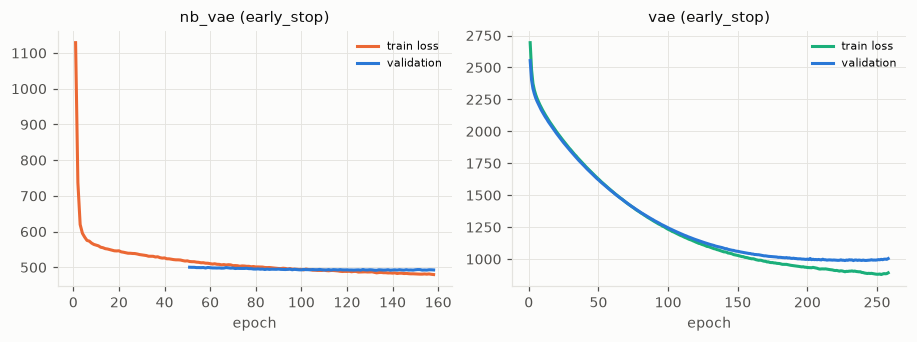
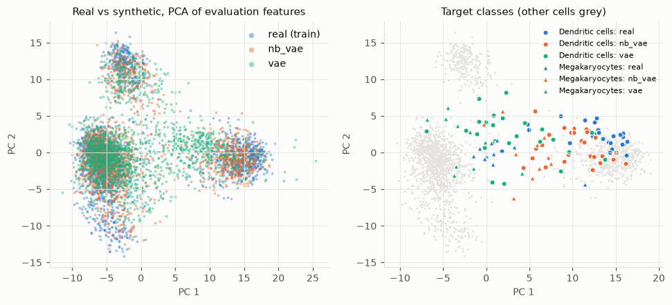
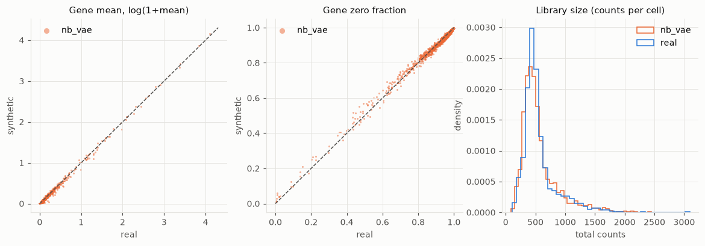
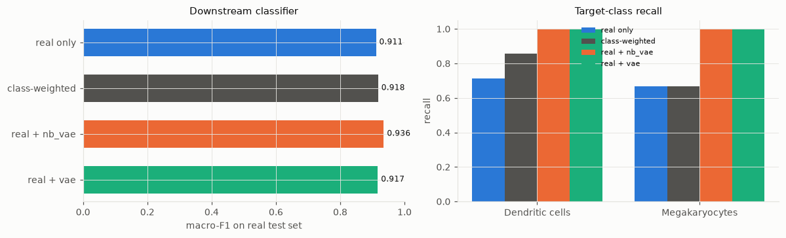

# Generative modeling report: pbmc3k_labeled

*Objective:* Generate realistic synthetic cells for rare cell types to support downstream cell-type classification.  
*Run:* 2026-10-05T22:21:32 on mps (Apple GPU (MPS) on arm64); full mode; seed 774; plan source **llm**; narrative by LLM (claude-opus-5-5); total time 3.9 min.

## 1. Executive summary
The objective was to generate realistic synthetic cells for the two rare classes in `pbmc3k_labeled` (2,638 cells × 32,738 genes; 8 classes; imbalance ratio 76.3): **Dendritic cells** (37 cells) and **Megakaryocytes** (15 cells). The goal was to support cell-type classification. The agent trained a conditional negative-binomial VAE (`nb_vae`) on the top 2,000 highly variable genes as the primary model, with a size-matched Gaussian VAE on log-normalised data as the comparison. It added 295 synthetic cells (205 Dendritic cells, 90 Megakaryocytes) to the training set. Overall fidelity of `nb_vae` is close to the real-holdout reference: Fréchet distance 12.4 vs 11.0, MMD 0.0088 vs 0.0048, coverage 0.967 vs 0.998, zero fraction 0.9255 vs 0.9257. No memorisation was flagged (DCR ratio 1.04, 0 exact copies). On the primary metric, target-class recall rose from 0.690 to 1.000 (gain +0.310, 95% CI [0.000, 0.688], P(gain>0) = 0.94). Against a class-weighted classifier the gain was +0.238 (CI [0.000, 0.600]). **Bottom line:** the synthetic cells look realistic in aggregate, but the classification benefit is not established. Both intervals reach zero, and the gain amounts to roughly 3 test cells (about 2 against class weighting). Augmentation should be treated as optional until it is re-tested on more real rare-class cells.

## 2. Data and objective
**What the profile showed that drove the decisions:**

- **Modality: UMI-like counts.** Values are non-negative integers in [0, 419], 97.4% zeros, stored sparse. Median library size is 2,214 (mean 2,373). Library size was used as an offset in the count model.
- **Overdispersion without zero inflation.** Among the 3,857 genes detected in ≥5% of cells:
  - 96.7% are overdispersed (median variance/mean 1.51).
  - Observed zeros (0.818) sit between the Poisson expectation (0.794) and the NB expectation (0.847), so excess zeros vs NB are −0.029.
  - ZINB is preferred by AIC for only 2.3% of genes, with a median fitted zero-inflation π of 0.016.
  - Together these pointed to an NB likelihood rather than Poisson or ZINB.
- **High dimension relative to sample size.** p = 32,738 against n = 2,638 (n/p = 0.081). Intrinsic dimension is about 170, and 200 PCs are needed for 90% of variance. This motivated restricting to 2,000 HVGs and using a small network.
- **Severe imbalance.** Class counts range from 1,144 (CD4 T cells) down to 37 (Dendritic cells) and 15 (Megakaryocytes, 0.57% of cells). After the stratified 70/10/20 split (train 1,846 / val 264 / test 528, seed 774):
  - 26 Dendritic cells and 10 Megakaryocytes were left for training.
  - 11 and 5 were left in the combined val+test holdout used for generative metrics.
  - Per-class recalls of 0.714 and 0.667 imply about 7 and 3 cells in the test set used for classification.
- **Clean input.** No missing values, no duplicates or near-duplicates, no predefined splits.

The objective was parsed heuristically as `class_balancing` (trigger word 'rare'), with `generation` as a secondary task and classification as the downstream task. Dendritic cells and Megakaryocytes were the target classes.

| profile | value |
|---|---|
| modality | counts |
| n samples | 2638 |
| n features | 32738 |
| feature types (cont/disc/bin/cat) | 32738/0/0/0 |
| classes | 8 (imbalance 76.3, smallest 'Megakaryocytes' n=15) |
| missing cells | 0.0% |
| zero fraction | 97.4% |
| PCA components for 90% variance | 200 |
| near-duplicate fraction | 0.0 |
| predefined splits | None |
| NB vs ZINB (genes preferring ZINB; median pi) | 0.02; 0.016 |

## 3. How the agent decided
**Whether to use a generative model.** The agent chose to use one: the objective explicitly asks for synthetic cells, and a conditional model trained on all classes can share structure with the rare ones, which the plan judged a better basis than interpolating among 15–37 cells. The alternative 'class weighting only' was rejected as a replacement but kept as a baseline that augmentation must beat. The plan flagged Megakaryocytes (about 10 training cells) as being at the memorisation limit.

**Preprocessing.** The agent modelled the top 2,000 HVGs (the standard Scanpy/Seurat choice). Using all 32,738 genes was rejected because p ≫ n and most genes are near-silent.

**Likelihood and primary model.** The primary model is `nb_vae`: a scVI-style conditional VAE with an NB likelihood and library-size offset.
- **ZINB** was rejected (see the zero-inflation statistics above).
- **Poisson** was rejected because it ignores overdispersion.
- **Other architectures rejected:**
  - **WGAN-GP:** no likelihood to monitor, and mode collapse could erase classes of about 10 cells.
  - **MLP diffusion (DDPM):** models transformed continuous values rather than counts, and needs more data than a few thousand cells.
  - **Normalising flows:** p far exceeds the roughly 200-d limit for full-rank flows.

**Comparison model.** A Gaussian VAE on log-normalised HVGs, with identical architecture (latent 10, hidden 128, 1 layer, β = 1, weight decay 1e-5). Because the architectures match, the comparison isolates the effect of the likelihood.

**Hyperparameters.** Settings followed rules of thumb: batch 128 (≈ n/20), latent dimension 10 (scVI default), max epochs 400 for `nb_vae`, learning rate 1e-3. The LLM planner made two changes to the rule-based proposal:
- It pinned β = 1.0 and weight decay 1e-5 for `nb_vae`, to limit overfitting to the 10 Megakaryocyte training cells.
- It pinned `n_layers = 1` for the comparison VAE, to keep the two models matched.

A larger network (hidden ≥ 256, 2 layers) was rejected because of the memorisation risk at n/p = 0.081.

**Sampling.** Each target class was raised to min(median size of the other classes ≈ 230, 10× its real count). The rationale was that beyond this, synthetic points are smoothed copies of a few real cells rather than new evidence. The result was 205 synthetic Dendritic cells and 90 synthetic Megakaryocytes. The Megakaryocyte figure is consistent with the 10× cap (90 synthetic + 10 real = 100).

**Evaluation.** Fidelity, diversity and memorisation were measured in PCA(50) of log-normalised HVG expression, fitted on real training data only. Inception-type features were rejected as mis-specified for these data. The primary metric is `target_class_recall_gain`, with real-only and class-weighted classifiers as baselines. AUPRC was added as a threshold-free check because recall on about 3 test cells moves in 33-point steps. However, **no AUPRC values appear in the evaluation record**, so that check cannot be reported. Two alternatives were rejected:
- Macro-F1 as primary, because averaging over 6 well-populated classes dilutes the rare-class signal.
- Raising the test fraction to 0.3, because it would add about 1 Megakaryocyte to the test set while removing about 1.5 of the 10 training cells.

Full decision log: `decision_log.json`. Summary:

| step | decision | chosen | source |
|---|---|---|---|
| system | compute | mps, full mode | system |
| profile | data modality | counts | system |
| objective | task type | class_balancing | heuristic |
| warrant | use a generative model? | yes | heuristic |
| preprocessing | genes modelled | top 2000 highly variable genes | heuristic |
| model | count likelihood | NB | heuristic |
| model | primary model | nb_vae | heuristic |
| model | comparison model | vae | heuristic |
| hyperparameters | nb_vae (primary) | batch_size=128, latent_dim=10, hidden_dim=128, n_layers=1, max_epochs= | heuristic |
| hyperparameters | vae (comparison) | batch_size=128, latent_dim=10, hidden_dim=128, beta=1.0, lr=0.001, wei | heuristic |
| sampling | how many samples, of what | rebalance_targets | heuristic |
| evaluation | evaluation criteria | precision_recall, density_coverage, frechet_distance, mmd, memorizatio | heuristic |
| warrant | Adopt generative augmentation, with an explicit caveat for M | use_generative_model = true | llm |
| hyperparameters | Set beta and weight_decay explicitly for nb_vae, and n_layer | nb_vae: beta=1.0, weight_decay=1e-5; vae: n_layers=1 | llm |
| evaluation | Add AUPRC as a supporting utility metric; keep target_class_ | metrics += auprc | llm |
| planner | planner used | llm | llm |
| preprocessing | data split | train 1846 / val 264 / test 528 | system |
| evaluation | feature space | PCA(50) of log-normalised expression of 2000 highly variable genes | system |
| critic | revise the plan? | none | critic |
| recommendation | verdict | No reliable effect of augmentation on target-class recall: +0.310 (95% | system |

## 4. Models and training

| model | role | representation | conditional | parameters | epochs | time (s) | stopped | hyperparameters |
|---|---|---|---|---|---|---|---|---|
| nb_vae | primary | counts_hvg | True | 797,188 | 158 | 10.2 | early_stop | latent_dim=10, hidden_dim=128, n_layers=1, beta=1.0, lr=0.001, batch_size=128, max_epochs=400, weight_decay=1e-05 |
| vae | comparison | lognorm_hvg | True | 522,164 | 258 | 19.0 | early_stop | latent_dim=10, hidden_dim=128, n_layers=1, beta=1.0, lr=0.001, batch_size=128, max_epochs=2000, weight_decay=1e-05 |

## 5. Evaluation
**Training.** Both models stopped early and well within the caps.
- `nb_vae`: 797,188 parameters; 158 epochs, best at epoch 133; 10.2 s. Final train loss 479.9 vs best validation loss 491.9, a small gap. Median NB inverse dispersion θ = 0.90.
- Gaussian VAE: 522,164 parameters; 258 epochs, best at 233; 19.0 s.
- The two models' losses use different likelihoods and are not comparable.

**Overall fidelity and diversity** (PCA-50 space; 792 synthetic vs 792 real holdout cells; reference = real train vs real holdout):

| Metric | nb_vae | Gaussian VAE | Real-holdout reference |
|---|---|---|---|
| Fréchet distance | 12.40 | 24.62 | 10.98 |
| MMD | 0.0088 | 0.0207 | 0.0048 |
| Mean marginal KS | 0.047 | 0.406 | 0.027 |
| Correlation mean abs diff | 0.039 | 0.043 | 0.033 |
| Precision | 0.973 | 0.914 | 0.999 |
| Recall | 0.329 | 0.307 | 0.262 |
| Density | 4.27 | 4.48 | 6.27 |
| Coverage | 0.967 | 0.858 | 0.998 |

`nb_vae` is close to, but measurably worse than, the real-vs-real reference on every distributional metric. MMD is about 1.8× the reference, and Fréchet distance is 13% above it. It is roughly twice as close as the Gaussian VAE on Fréchet distance and MMD. The most striking difference is the mean marginal KS: 0.047 vs 0.406, which suggests the Gaussian model badly misrepresents per-component marginals.

The k-NN recall metric is low for all three rows. The real-vs-real reference itself is only 0.262, so recall should be read relative to that reference rather than against 1. Density below the reference (4.27 vs 6.27) means synthetic cells sit somewhat less densely around real cells than real cells do.

**Count-level marginals (nb_vae).**
- Zero fraction: 0.9255 synthetic vs 0.9257 real.
- Gene-mean correlation 0.998; gene zero-fraction correlation 0.997.
- Gene-variance correlation is weaker at 0.915.
- Library-size KS is 0.073.

Mean expression and sparsity are reproduced very well. Gene-level variance and library-size distributions are reproduced less exactly.

**Target classes (per-class PRDC, k = 5; synthetic n matched to real-train n).**
- **Dendritic cells** (26 train / 11 holdout / 26 synthetic): `nb_vae` precision 0.92, recall 0.77, coverage 0.88, density 0.88. The Gaussian VAE reaches recall 0.92 but precision only 0.31, coverage 0.31 and density 0.12, meaning most of its Dendritic-cell samples fall outside the real Dendritic-cell manifold.
- **Megakaryocytes** (10 train / 5 holdout / 10 synthetic): `nb_vae` precision 0.90 but recall 0.20, coverage 0.20 and density 0.28. Synthetic Megakaryocytes look plausible but probably cover only part of the class's real variation. Each of these values rests on 5 holdout and 10 synthetic cells: a coverage of 0.2 is 1 of 5 holdout cells. The Gaussian VAE is worse here (recall 0.0, coverage 0.1).

**Memorisation.**
- Overall `nb_vae`: median distance-to-closest-record 12.44 for synthetic vs 12.01 for holdout (ratio 1.04); 0 exact copies; 1.6% too-close against the roughly 5% expected; Mann–Whitney p (synthetic closer) = 1.0. No flag.
- Per class, the DCR ratios are 1.26 (Dendritic cells) and 2.16 (Megakaryocytes), with 0 too-close in each. Synthetic rare cells are therefore not copies of training cells.
- For Megakaryocytes, a DCR ratio of 2.16 together with low coverage is consistent with samples that sit farther from the real cells than real holdout cells do. They are not copies, but the 10-cell sample cannot distinguish this from chance.

**Utility** (multinomial logistic regression on standardised PCA-50 features; 3 seeds; reported seed SD ≈ 0):

| Classifier | Macro-F1 | Balanced acc. | Target recall | DC recall | Mk recall |
|---|---|---|---|---|---|
| Real only | 0.911 | 0.878 | 0.690 | 0.714 | 0.667 |
| Class-weighted | 0.918 | 0.896 | 0.762 | 0.857 | 0.667 |
| + nb_vae synthetic | 0.936 | 0.951 | 1.000 | 1.000 | 1.000 |
| + Gaussian VAE synthetic | 0.917 | 0.947 | 1.000 | 1.000 | 1.000 |

The gains with bootstrap intervals were:
- **Target recall gain** (`nb_vae` vs real only): +0.310, 95% CI [0.000, 0.688], P(>0) = 0.94.
- **Target recall gain vs class-weighted:** +0.238, CI [0.000, 0.600], P(>0) = 0.88.
- **Macro-F1 gain** vs real only: +0.024, CI [−0.037, 0.136], P(>0) = 0.75.
- **Macro-F1 gain vs class-weighted:** +0.018, CI [−0.037, 0.130], P(>0) = 0.70.

**Reading this candidly:**
- With about 7 Dendritic-cell and about 3 Megakaryocyte test cells, the recall gain over real-only corresponds to about 2 more Dendritic cells and 1 more Megakaryocyte classified correctly. Over class weighting it is about 1 more of each.
- All the target-recall intervals have a lower bound of exactly 0. Macro-F1 intervals include zero.
- The rule-based verdict is therefore 'no reliable effect'. The direction is favourable (P(gain>0) = 0.88–0.94), but the size is not established.
- Augmentation slightly lowered recall for some common classes: CD14+ Monocytes 0.979 → 0.969, CD4 T 0.983 → 0.978, CD8 T 0.841 → 0.825. These shifts are small and may reflect single cells.
- The Gaussian VAE gives an identical target-recall gain (+0.310) despite far worse fidelity. The utility benefit therefore does **not** discriminate between a realistic and an unrealistic generator. Plausibly, simply adding more labelled points in the target-class region shifts the linear classifier's decision boundary. Only the fidelity metrics separate the two models.

Feature space: PCA(50) of log-normalised expression of 2000 highly variable genes. Real train n=1846; reference holdout = validation + test splits (both drawn IID by the agent), n=792; synthetic sets scored at the holdout's n.

### Fidelity, diversity, memorization

| | precision | recall | density | coverage | frechet_distance | mmd | marginal_ks_mean | correlation_mean_abs_diff | dcr_ratio | too_close_fraction | mannwhitney_p_synth_closer | memorization_flag | n_synth_eval |
|---|---|---|---|---|---|---|---|---|---|---|---|---|---|
| real holdout, IID (reference) | 0.999 | 0.262 | 6.270 | 0.998 | 10.979 | 0.005 | 0.027 | 0.033 | nan | nan | nan | nan | nan |
| nb_vae | 0.973 | 0.329 | 4.267 | 0.967 | 12.398 | 0.009 | 0.047 | 0.039 | 1.035 | 0.016 | 1.000 | False | 792 |
| vae | 0.914 | 0.307 | 4.479 | 0.858 | 24.616 | 0.021 | 0.406 | 0.043 | 1.055 | 0.000542 | 1.000 | False | 792 |

Downstream classifier: multinomial logistic regression (C=1, lbfgs) on standardised evaluation features (PCA(50) of log-normalised expression of 2000 highly variable genes).

### Target classes

| | precision | recall | density | coverage | dcr_ratio | too_close_fraction | n_real_train | n_real_holdout | n_synth | k_nn |
|---|---|---|---|---|---|---|---|---|---|---|
| nb_vae: Dendritic cells | 0.923 | 0.769 | 0.877 | 0.885 | 1.262 | 0.000 | 26.000 | 11.000 | 26.000 | 5.000 |
| nb_vae: Megakaryocytes | 0.900 | 0.200 | 0.280 | 0.200 | 2.163 | 0.000 | 10.000 | 5.000 | 10.000 | 5.000 |
| vae: Dendritic cells | 0.308 | 0.923 | 0.115 | 0.308 | 1.841 | 0.000 | 26.000 | 11.000 | 26.000 | 5.000 |
| vae: Megakaryocytes | 0.500 | 0.000 | 0.100 | 0.100 | 2.344 | 0.000 | 10.000 | 5.000 | 10.000 | 5.000 |

### Downstream utility (real test set)

| | macro_f1 | macro_f1_sd | balanced_accuracy | target_class_recall | n_seeds |
|---|---|---|---|---|---|
| real only | 0.911 | 1.11e-16 | 0.878 | 0.690 | 3.000 |
| real only, class-weighted | 0.918 | 0.000 | 0.896 | 0.762 | 3.000 |
| real + nb_vae | 0.936 | 0.000 | 0.951 | 1.000 | 3.000 |
| real + vae | 0.917 | 0.000 | 0.947 | 1.000 | 3.000 |

Gains with paired-bootstrap 95% intervals:

| | gain | ci_low | ci_high | prob_positive |
|---|---|---|---|---|
| nb_vae: augmented - real: macro-F1 | 0.024 | -0.037 | 0.136 | 0.751 |
| nb_vae: augmented - real: target recall | 0.310 | 0.000 | 0.688 | 0.938 |
| nb_vae: augmented - class-weighted: macro-F1 | 0.018 | -0.037 | 0.130 | 0.695 |
| nb_vae: augmented - class-weighted: target recall | 0.238 | 0.000 | 0.600 | 0.879 |
| vae: augmented - real: macro-F1 | 0.006 | -0.080 | 0.117 | 0.599 |
| vae: augmented - real: target recall | 0.310 | 0.000 | 0.700 | 0.950 |
| vae: augmented - class-weighted: macro-F1 | -0.000931 | -0.075 | 0.103 | 0.556 |
| vae: augmented - class-weighted: target recall | 0.238 | 0.000 | 0.600 | 0.885 |

*Real vs synthetic in the evaluation feature space (PCA).*

*Per-gene statistics, synthetic vs real.*

*Downstream classifier by training condition.*

## 6. Critic and revision
The critic judged the run **adequate** and proposed **no revision** (`action = none`), so no revision ran (`revision.ran = false`). The selected model remains `nb_vae`.

**Critic's reasoning:**
- **Ceiling on the primary metric.** Augmented target-class recall is already 1.000, so no revision could raise `target_class_recall_gain` above +0.310. Revisions are only kept if the primary metric improves, so retraining had no possible payoff on that metric.
- **Noise.** With about 7 and 3 test cells in the target classes, any further change would be measured on noise.
- **Model choice.** `nb_vae` clearly beats the Gaussian VAE on fidelity: Fréchet 12.4 vs 24.6, MMD 0.0088 vs 0.0207, marginal KS 0.047 vs 0.406, Dendritic-cell precision 0.92 vs 0.31. Both give the same primary gain, so there is no reason to switch.
- **Training health.** Early stopping at epoch 133 of 158 (cap 400) and the small train/validation gap (480 vs 492) gave no sign of a hyperparameter problem.
- **Main weakness.** The critic named Megakaryocyte coverage and recall (0.2) and density (0.28) as the main weakness, while noting the 5-cell holdout.

**Alternatives the critic rejected:**
- Re-tuning `nb_vae` (lower β to 0.5, or a larger latent space) to improve Megakaryocyte coverage. Reasons: no possible primary-metric gain, a coverage estimate based on 5/10 cells, and higher memorisation risk with lower β.
- Switching to the Gaussian VAE. Reasons: worse fidelity, Megakaryocyte recall 0.0, and macro-F1 −0.001 vs class weighting.
- Switching to a ZINB VAE. Reasons: only 2.3% of genes prefer ZINB, and NB already matches the zero fraction.
- Switching to diffusion on log-normalised PCA. Reasons: it would lose the count likelihood, carries higher memorisation risk, and the metric is already at ceiling.

**Comment.** The decision not to revise is defensible. However, the ceiling argument cuts both ways: because the primary metric saturated, it cannot tell better generators from worse ones. This run leaves the Megakaryocyte coverage weakness unresolved, not refuted. The critic's 'adequate' assessment should be read alongside the rule-based verdict that the gain is not statistically reliable. The critic itself recommended re-checking the gain on a larger or cross-validated split, because the CI lower bound sits at 0.

## 7. Recommended downstream use
- **Treat augmentation as optional, not proven.** The target-recall gain is +0.310 (95% CI [0.000, 0.688]) over real-only and +0.238 (CI [0.000.600]) over class weighting. If used, also keep the class-weighted classifier as a reference.
- **Use `nb_vae`, not the Gaussian VAE**, as the source of synthetic cells. Both give the same utility gain, but `nb_vae` has much better fidelity (Fréchet 12.4 vs 24.6; Dendritic-cell precision 0.92 vs 0.31).
- **Use synthetic cells only to augment classifier training.** Add them to the training fold only, and keep them labelled as synthetic (`is_synthetic` flag).
- **Keep within the sampling caps:** at most 205 Dendritic cells and 90 Megakaryocytes from this run (≤ 10× real count). Larger amounts are smoothed copies of 26 and 10 real cells, not new information.
- **Re-validate before relying on the effect size.** Use repeated stratified or cross-validated splits, and preferably an external labelled PBMC dataset with more Dendritic cells and Megakaryocytes, so that recall is not decided by about 3–7 test cells.
- **Add a simple oversampling baseline** (random duplication or SMOTE in PCA space) to test whether the generator adds anything beyond resampling. The Gaussian VAE matching the gain suggests it may not.
- **Report AUPRC per target class** in follow-up runs. It was planned but no values appear in this record.
- **Be most cautious with Megakaryocytes.** Synthetic coverage was 0.2 on 5 holdout cells. Prefer class weighting or collecting more real cells if the classifier must generalise across Megakaryocyte variation.
- **Privacy:** no memorisation signal (DCR ratio 1.04; 0 exact copies). That is not a formal guarantee, so formal privacy protection (e.g. differential privacy) is needed before any external release.

### Do not use the generated data for
- **Never use synthetic cells as test or validation data.** All performance must be measured on held-out real cells.
- **Do not estimate biological or population quantities** from synthetic cells: no differential expression, marker discovery, cell-type proportions, prevalence, or gene–gene correlation claims. The generator only reproduces what it saw, and gene-variance correlation was 0.915, not 1.
- **Do not characterise rare classes from the synthetic data.** Synthetic Dendritic cells come from 26 real training cells and Megakaryocytes from 10. They cannot reveal new subtypes, states or heterogeneity. Megakaryocyte coverage was only 0.2.
- **Do not cite the +0.310 recall gain as an established effect.** The 95% CI reaches 0 and the gain amounts to about 3 test cells.
- **Do not pool synthetic and real cells without provenance.** Label synthetic records wherever they are stored or shared.
- **Do not transfer this generator** to other datasets, batches, tissues or chemistries. It was trained on one PBMC sample of 2,638 cells and 2,000 HVGs.
- **Do not treat 'no memorisation flag' as a privacy guarantee.**
- **Do not use the generated cells for genes outside the 2,000 HVGs.** The other 30,738 genes were not modelled.

## 8. Limitations
- **Very small rare-class test sets.** About 7 Dendritic cells and 3 Megakaryocytes decided the primary metric. Recall moves in steps of about 14 and 33 points, and every target-recall interval has a lower bound of 0.
- **Ceiling effect.** Augmented target recall hit 1.000 for both generators, so the primary metric could not rank models or justify a revision.
- **The utility gain does not depend on generator quality.** The Gaussian VAE (Fréchet 24.6, Dendritic-cell precision 0.31) gave the same +0.310. The benefit may come from oversampling per se. No random-duplication or SMOTE baseline was run to test this.
- **Planned AUPRC is missing** from the evaluation record, so the threshold-free check was not delivered.
- **Rare-class fidelity rests on tiny samples:** 11/26 and 5/10 holdout/synthetic cells for Dendritic cells and Megakaryocytes, with k = 5 nearest neighbours. Megakaryocyte coverage of 0.2 is 1 of 5 cells.
- **One split (seed 774)** for the generator. The 3 classifier seeds gave SD ≈ 0, so the intervals reflect test-set bootstrap only, not variation in generator training or data splitting.
- **Evaluation space is limited.** Metrics were computed in PCA(50) of log-normalised HVGs. The data need about 200 PCs for 90% of variance (intrinsic dimension ≈ 170), so fidelity in the remaining variance is unmeasured. Count-level checks cover only marginals.
- **Only a linear classifier** (multinomial logistic regression) was tested. Results may differ for other classifiers.
- **One dataset, one run.** No hyperparameter search was done beyond rule-based defaults plus two LLM adjustments. Training was short (10.2 s), and the results come from a single small public PBMC sample.

## 9. Reproducibility

- Command: `/Users/loulindsley/Projects/774_genmodel/.venv/bin/genagent run --data data/pbmc3k_labeled.h5ad --objective Generate realistic synthetic cells for rare cell types to support downstream cell-type classification. --out outputs/generated_report_2`
- Git commit: `54c6c60a4cb10a6c5b519a48106fdba0c690edc5`; Python 3.12.14; torch 2.14.1, numpy 2.2.6, scikit-learn 1.9.1, scanpy 1.12.4, pandas 3.0.6, claude-agent-sdk 0.2.163
- LLM: model claude-opus-5-5, 3 calls, $0.6849; responses cached under the run directory (`--replay` reproduces the run without LLM access).
- Files: `decision_log.json`, `plan.json`, `profile.json`, `evaluation.json`, `tables/*.csv`, `model_summary.json`, `recommendations.json`, `synthetic_sample/`, `run_manifest.json`.
